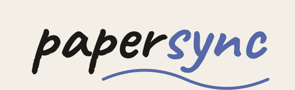

  

<h1 align="center">Papersync for Obsidian</h1>

  
  
  
  
  
  

Snap a handwritten page with the Papersync phone app, and this plugin files it into that day's note as Markdown.

## Before you start

You need the [Papersync app](https://papersync.ai) and an API key for the AI provider you pick in it (Anthropic, OpenAI, Gemini, OpenRouter, Ollama and others). The key stays in the app, which sends each page straight to that provider. Some providers charge for use. There is no Papersync server. This plugin is free and works with Obsidian on desktop only.

Get the app on [Google Play](https://play.google.com/store/apps/details?id=ai.papersync.app). The iPhone app is coming soon.

## Setup

1. In the app, choose where scans are saved: Google Drive, or a folder your computer syncs (iCloud Drive, Dropbox, OneDrive, Syncthing).
2. In the plugin's settings, connect the same place. For Google Drive, sign in with the Google account the app uses.

Scans already waiting are imported as soon as you connect, so edit the template first if you want a different layout.

If a scan's photo was moved or deleted, its text still imports without a broken image embed. If your template shows only the photo, that scan's text is added instead, so it never imports empty. When a photo is first absent, the plugin allows up to one minute for it to finish syncing (with Google Drive, up to five minutes after the scan was uploaded), then rechecks automatically. Photo access or download errors remain retryable and do not mark the scan imported.

## Privacy

- Folder sync reads scans and photos from the folder you select outside your vault and updates each imported scan's synced flag. Setup checks common sync locations to find existing Papersync folders and searches up to two levels below a folder you pick. On macOS, it asks iCloud to download offloaded scan files; your sync service may use the network. The plugin itself makes no network requests in folder mode.
- Google Drive sync needs a Google account. It talks only to Google to sign in, read scans and photos, and mark scans imported, using the `drive.file` scope. Sign-in uses a temporary callback on your computer at `127.0.0.1`. The sign-in token is kept in Obsidian's secret storage, never in `data.json`. Details in [SECURITY.md](SECURITY.md).
- Desktop only because folder sync needs file access outside the vault (Node.js `fs`) and, on macOS, runs Apple's `brctl download` on a scan file to fetch it from iCloud (`child_process`, that one command with the file path, nothing else).
- No telemetry or analytics.

## Installation

Install Papersync from **Settings › Community plugins** in Obsidian. To install by hand instead, copy `main.js`, `manifest.json` and `styles.css` from the [latest release](https://github.com/Papersync/obsidian-papersync/releases/latest) into `<vault>/.obsidian/plugins/papersync/`.

## Support

Questions go in [Discussions](https://github.com/Papersync/obsidian-papersync/discussions/categories/q-a). [Open an issue](https://github.com/Papersync/obsidian-papersync/issues/new/choose) for bugs and ideas. Security reports: [SECURITY.md](SECURITY.md). Building from source: [CONTRIBUTING.md](CONTRIBUTING.md).

Licensed under [MIT](LICENSE).

Google Play is a trademark of Google LLC.
